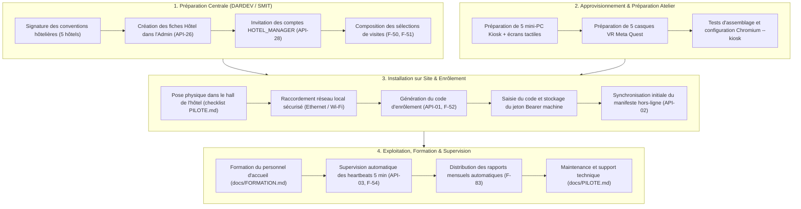

# Backlog Phase 2 et Feuille de Route — Projet Xplor

> **Référence :** Cahier des charges Xplor v2.0 — Jalon **M9 — Livraison** (S38–S39), Section 2.2 (« Exclu de la phase 1 »), Section 5 (Modèle de données), Section 6 (Exigences fonctionnelles), Section 8 (Exigences non fonctionnelles NF-03 et NF-10), Section 9 (Calendrier et jalons), `docs/DECISIONS.md` et `docs/PROGRESS.md`.  
> **Statut :** Document de travail pour la transition vers la Phase 2. Les niveaux de priorité indiqués ci-dessous (Haute, Moyenne, Basse) sont des **propositions** soumises à l'arbitrage et à la décision du porteur du projet.

Ce document consigne l'ensemble des éléments exclus du périmètre initial de la Phase 1, les fonctionnalités reportées, les hypothèses et choix techniques soumis à validation du porteur, ainsi que les jalons opérationnels préalables au passage à l'échelle. Il structure également le plan d'installation et de déploiement de la solution dans 5 établissements hôteliers partenaires.

---

## 1. Tableau Synthétique du Backlog de Phase 2

Le tableau ci-dessous recense les exigences, fonctionnalités et chantiers identifiés pour la Phase 2, avec leur origine formelle (cahier des charges v2.0, décisions `D-xx` de `docs/DECISIONS.md`, points de suivi porteur de `docs/PROGRESS.md`), leur niveau de priorité proposé et les remarques associées.

> [!NOTE]
> **Statut des priorités :** Les niveaux de priorité indiqués ci-dessous (Haute, Moyenne, Basse) sont des **propositions** soumises à l'arbitrage et à la décision du porteur du projet.

| Identifiant | Intitulé | Origine (Document / Décision) | Priorité proposée | Remarque |
|---|---|---|---|---|
| **BP2-EX01** | Paiement en ligne | Cahier des charges v2.0 §2.2 (« Exclu de la phase 1 ») | Moyenne | Paiement en ligne sur la plateforme, exclu de la phase 1 et prévu pour la phase 2 ou plus tard. |
| **BP2-EX02** | Réservation d'excursions | Cahier des charges v2.0 §2.2 (« Exclu de la phase 1 ») | Haute | Réservation d'excursions depuis la plateforme, exclue de la phase 1 et prévue pour la phase 2 ou plus tard. |
| **BP2-EX03** | Application mobile native | Cahier des charges v2.0 §2.2 (« Exclu de la phase 1 ») | Basse | Application mobile native, exclue de la phase 1 (en phase 1, le web responsive et la consultation par lien public `/v/<jeton>` et QR code couvrent le besoin mobile). |
| **BP2-EX04** | Comptes clients finaux | Cahier des charges v2.0 §2.2 (« Exclu de la phase 1 ») | Basse | Comptes clients finaux, exclus de la phase 1 (en phase 1, fonctionnement anonyme sans collecte de données personnelles de voyageurs, conformité loi 09-08). |
| **BP2-EX05** | Recommandations par IA | Cahier des charges v2.0 §2.2 (« Exclu de la phase 1 ») | Basse | Recommandations par intelligence artificielle, exclues de la phase 1 et prévues pour la phase 2 ou plus tard. |
| **BP2-EX06** | Vidéos 360° en streaming adaptatif | Cahier des charges v2.0 §2.2 (« Exclu de la phase 1 ») | Moyenne | Vidéos 360° en streaming adaptatif, exclues de la phase 1 (la phase 1 étant concentrée sur les panoramas photos fixes équirectangulaires tuilés). |
| **BP2-EX07** | Marketplace de contenus tiers | Cahier des charges v2.0 §2.2 (« Exclu de la phase 1 ») | Basse | Marketplace de contenus tiers, exclue de la phase 1 et prévue pour la phase 2 ou plus tard. |
| **BP2-MAP** | Positionnement sur le plan de la visite (`mapX`, `mapY`) | Cahier des charges v2.0 §5.3 (`Scene`, mention phase 2) | Haute | Champs `mapX` et `mapY` (Float 0–1) modélisés dans le schéma Prisma `Scene` avec mention explicite phase 2 au cahier des charges : exploitation du plan de visite dans l'interface et la visionneuse. |
| **BP2-F25** | Carte des liens et graphe de visite | Cahier des charges v2.0 §6.3 et §9 | Basse | Mentionnée au cahier des charges §9 comme reportable en phase 2 en cas de dérapage du jalon VR (M6). Réalisée en phase 1 (M4, `D-114`). Évolutions ergonomiques éventuelles en phase 2. |
| **BP2-F83** | Rapport mensuel par hôtel | Cahier des charges v2.0 §6.9 et §9 | Basse | Mentionné au cahier des charges §6.9 et §9 comme reportable en phase 2 [HYPOTHÈSE]. Réalisé en phase 1 (M7, `D-135`, `D-136`, génération PDF vectorielle et envoi SMTP mensuel planifié). |
| **BP2-VR3D** | Panneaux d'information 3D en réalité virtuelle | Cahier des charges v2.0 §6.8, `D-129` | Moyenne | En phase 1, les fiches `INFO` en WebXR sont projetées en 2D sur Canvas (`createInfoPanel`). Évolution vers des panneaux 3D en réalité virtuelle. |
| **BP2-D118** | Réordonnancement de la sélection hôtel par glisser-déposer | `docs/DECISIONS.md` (`D-118`, M5 F-51) | Moyenne | En phase 1, l'ordre des visites se règle avec les boutons monter/descendre ; le glisser-déposer interactif a été reporté (décision `D-118`, à valider : oui). |
| **BP2-D121** | Calcul dynamique de la taille du manifeste kiosque (`sizeBytes`) | `docs/DECISIONS.md` (`D-121`, M5 API-02) | Moyenne | `sizeBytes` vaut temporairement `0` dans `GET /api/v1/kiosk/manifest` ; calcul réel de la taille des médias synchronisables reporté (décision `D-121`, à valider : oui). |
| **BP2-D99** | Distribution des médias non-panoramas par dérivés publics | `docs/DECISIONS.md` (`D-99`, M2/M3) | Basse | Médias non-panoramas servis par URL présignées S3 valables 1 h ; alternative : dérivés publics générés par le worker (décision `D-99`, à valider : oui). |
| **BP2-D112** | Annulation étendue et corbeille de hotspots | `docs/DECISIONS.md` (`D-112`, M4 F-22) | Basse | Annuler/rétablir couvre les déplacements pendant la session d'édition ; suppression confirmée et non annulable (décision `D-112`, à valider : oui). Gestion de corbeille ou restauration envisageable. |
| **BP2-D125** | Packaging kiosque dédié (Electron / Tauri ou OS kiosque) | `docs/DECISIONS.md` (`D-125`, M5 F-60) | Moyenne | Kiosque sous Chromium `--kiosk` sur mini-PC ; alternative : conteneur applicatif dédié (Tauri/Electron) ou distribution Linux Kiosk OS (décision `D-125`, à valider : oui). |
| **BP2-CONT** | Production et publication de ≥ 15 visites virtuelles | Cahier des charges v2.0 §9 (Piste parallèle — équipe création) | Haute | Tournages Insta360 et intégration éditoriale de 15 visites minimum en fr/ar/en [HYPOTHÈSE — Cahier des charges §9]. Volume requis pour composer les sélections des 5 hôtels. |
| **BP2-NF03** | Mesures réelles de charge et performance (k6) | `docs/PROGRESS.md` (Critère 3 M8), `docs/PERFORMANCE.md` | Haute | Scripts k6 rédigés (`admin-api.js`, `manifest.js`, `events.js`) ; mesures de performance réelles à exécuter par le porteur en local/préprod pour valider les métriques P95. |
| **BP2-QUEST** | Validation matérielle sur casque Meta Quest Browser (F-71) | `docs/PROGRESS.md` (Tâche en cours M6), `docs/VALIDATION_QUEST.md` | Haute | Protocole rédigé dans `docs/VALIDATION_QUEST.md` ; validation matérielle de la navigation main/manette à exécuter sur casque physique Meta Quest par le porteur. |
| **BP2-REC** | Exécution et signature du PV de Recette Fonctionnelle | `docs/PROGRESS.md` (Critère 11 M8), `docs/RECETTE.md`, `docs/PV_RECETTE.md` | Haute | Déroulement des 12 scénarios de recette (R-01 à R-12) et signature du procès-verbal de recette à exécuter par le porteur. |
| **BP2-PILOTE** | Exploitation du pilote dans 1 hôtel partenaire | `docs/PROGRESS.md` (Critère 12 M8), `docs/PILOTE.md` | Haute | Déploiement physique sur site de la première borne, protocole opérationnel et consolidation du retour d'expérience à mener par le porteur. |

---

## 2. Déploiement dans 5 Hôtels

Le jalon M9 acte la livraison d'une plateforme en production (`api.xplor.ma`, `admin.xplor.ma`, `v.xplor.ma`), prête pour la Phase 2 : **le déploiement opérationnel dans 5 hôtels partenaires 4★, 5★ et de luxe de la région pilote (Rabat-Salé-Kénitra)**.

Ce plan de déploiement s'appuie sur le protocole méthodologique du pilote (`docs/PILOTE.md`), l'architecture technique multi-tenant cloisonnée (`packages/shared`, `AccessPolicy`, `API-26` / `API-27`), les guides utilisateurs (`docs/GUIDE_GESTIONNAIRE_HOTEL.md`, `docs/FORMATION.md`) et les procédures d'exploitation sécurisées (`docs/DEPLOY.md`, `docs/EXPLOITATION.md`).

### 2.1 Périmètre et Objectifs du Déploiement

- **Établissements cibles :** 5 hôtels classés 4 étoiles, 5 étoiles ou de luxe situés dans la région pilote de Rabat-Salé-Kénitra (Cahier des charges §9 Jalon M9, `PASSATION_XPLOR.md` §Projet).
- **Dotation par établissement [HYPOTHÈSE — Cahier des charges §11.2, docs/PILOTE.md §2] :**
  - **1 Borne interactive tactile de hall :** Mini-PC sous Windows ou Linux Ubuntu Kiosk, écran tactile (zones d'interaction ≥ 48 px conformément à l'exigence d'accessibilité NF-05), châssis sécurisé (Cahier des charges §11.2, `docs/PILOTE.md` §2).
  - **1 Casque de réalité virtuelle autonome :** Casque VR autonome (ex. Meta Quest 3) avec contrôleurs, mode WebXR sur Meta Quest Browser (Cahier des charges §11.2, `docs/PILOTE.md` §2).
  - **1 Point d'accès ou liaison réseau :** Câblage Ethernet RJ45 privilégié ou liaison Wi-Fi avec flux sortants HTTPS (port 443 TCP) vers les domaines de la plateforme Xplor (`docs/PILOTE.md` §2).
- **Objectifs opérationnels :**
  - Disponibilité technique mesurée de la borne ≥ 99,0 % sur chaque site (`docs/PILOTE.md` §5).
  - Fonctionnement autonome 100 % hors-ligne garanti après synchronisation initiale du catalogue de l'hôtel (`F-62`).
  - Zéro donnée personnelle de voyageur collectée (conformité stricte à la loi marocaine 09-08, `NF-02`, `AGENTS.md`).

---

### 2.2 Prérequis Techniques et Infrastructurels

1. **Infrastructure Centrale VPS de Production :**
   - Serveur VPS Ubuntu 24.04 (`187.7.31.208`) administré exclusivement par le porteur du projet (DARDEV, décision du 04/10/2026, `docs/DEPLOY.md`).
   - Services conteneurisés Docker : reverse-proxy Caddy (terminaison HTTPS et en-têtes CSP/HSTS), API NestJS Fastify (`api.xplor.ma`), Worker BullMQ de traitement d'arrière-plan, base de données PostgreSQL 16 (`xplor_prod`), Redis 7 pour le cache et les files de messages, serveur d'objets MinIO (`media.xplor.ma`).
   - Rétention des sauvegardes portée à 30 jours (`deploy/backup.sh` via `BACKUP_RETENTION_DAYS=30`), vérifiée par tests de restauration réels (`deploy/restore.sh`, exigence M9 NF-10).
   - Rotation des journaux Docker configurée sur tous les conteneurs (`max-size: 10m`, `max-file: 3`).

2. **Catalogue de Contenus Virtuels Prêt au Déploiement :**
   - Objectif de ≥ 15 visites virtuelles publiées [HYPOTHÈSE — Cahier des charges §9 Piste parallèle] (panoramas 8192×4096 px découpés en tuiles multi-résolutions par sharp, conformes `F-11`).
   - Textes descriptifs et navigation disponibles en français, arabe et anglais (`D-03`, `D-142`).
   - Sites touristiques de la région (ex. Kasbah des Oudayas, Jardin de Salé, Plage de Mehdia, `D-27`).

---

### 2.3 Procédure de Déploiement par Établissement (Checklist Opérationnelle)

Chaque hôtel fait l'objet d'un déploiement séquentiel en 5 étapes, conduit par le porteur du projet :

#### Étape 1 : Paramétrage administratif et conventionnel
1. Création de la fiche établissement dans le back-office administrateur (`POST /api/v1/admin/hotels`, `API-26`) : raison sociale, adresse, ville, catégorie (étoiles), coordonnées géographiques et coordonnées du contact référent.
2. Création et envoi de l'invitation au gestionnaire d'hôtel désigné (`POST /api/v1/admin/users/invite`, `API-28`) avec le rôle `HOTEL_MANAGER` et rattachement exclusif à l'hôtel (`UserHotel`, `D-116`).
3. Activation du compte gestionnaire par le destinataire (choix d'un mot de passe fort ≥ 12 caractères, `F-90`).

#### Étape 2 : Configuration de la sélection éditoriale personnalisée
1. Connexion du gestionnaire d'hôtel sur `https://admin.xplor.ma`.
2. Composition de la sélection de visites de l'établissement (`PUT /api/v1/admin/hotels/:id/selection`, `API-27`, `F-50`) parmi le catalogue des visites publiées.
3. Ordonnancement des visites selon les recommandations d'accueil de l'hôtel (boutons monter/descendre, `F-51`).

#### Étape 3 : Installation matérielle sur site et raccordement
1. Implantation de la borne dans la zone d'accueil (hall principal, salon d'attente ou conciergerie) à proximité d'une prise d'alimentation secteur et d'un raccordement réseau (Ethernet ou Wi-Fi, `docs/PILOTE.md` §3).
2. Fixation et sécurisation du mini-PC et de l'écran tactile dans le meuble.
3. Raccordement réseau et vérification de la connectivité sortante HTTPS vers `https://api.xplor.ma` (port 443).
4. Configuration du système d'exploitation hôte (`docs/PILOTE.md` §2) :
   - Démarrage automatique sur la session dédiée (autologin).
   - Lancement automatique du navigateur en mode plein écran exclusif (`--kiosk https://v.xplor.ma/kiosk`, `D-125`, `docs/PILOTE.md` §3).
   - Configuration des plages de veille du système ou gestion de la veille applicative du kiosque (`F-63`).

#### Étape 4 : Enrôlement logique et synchronisation initiale
1. Depuis le back-office DARDEV, génération d'un code d'enrôlement à 8 caractères à usage unique (`POST /api/v1/admin/kiosks/:id/code`, `API-01`, `F-52`).
2. Saisie du code à 8 caractères sur l'écran d'enrôlement de la borne PWA (`.kiosk-enroll-input`).
3. Validation et récupération du jeton machine Bearer stocké de manière persistante en `localStorage` (`xplor.kiosk.credentials`).
4. Déclenchement automatique de la synchronisation initiale via le manifeste de l'hôtel (`GET /api/v1/kiosk/manifest`, `API-02`) : téléchargement et mise en cache locale (Cache Storage et IndexedDB) des panoramas, vignettes et métadonnées.
5. Configuration et test du code PIN technique de maintenance (`F-67`, `D-123`, `D-127`).
6. **Test de résilience hors-ligne :** déconnexion physique du câble réseau ou coupure du Wi-Fi, navigation complète à travers les visites de la sélection pour attester du fonctionnement hors-ligne (`F-62`), puis reconnexion.

#### Étape 5 : Formation des équipes de l'établissement et recette sur site
1. Organisation d'une session de formation auprès de l'équipe de l'établissement selon le programme du **Module 2 de `docs/FORMATION.md`** :
   - Présentation des fonctionnalités du kiosque et du partage mobile par QR code (`?src=kiosk&h=...`).
   - Accompagnement des voyageurs et démonstration du casque VR autonome.
   - Utilisation du code PIN technique pour accéder au panneau de maintenance.
   - Consultation du tableau de bord de fréquentation de l'hôtel sur `admin.xplor.ma`.
2. Remise d'un exemplaire du **`docs/GUIDE_GESTIONNAIRE_HOTEL.md`**.
3. Signature conjointe de la fiche d'installation et de mise en service opérationnelle (`docs/PILOTE.md` §3).

---

### 2.4 Supervision, Maintenance et Incidentologie Multi-Sites

Le déploiement sur 5 sites simultanés repose sur les mécanismes de supervision et de maintenance formalisés dans le projet :

1. **Supervision continue par Heartbeat (`F-54`, `API-03`) :**
   - Chaque borne envoie automatiquement un battement de cœur toutes les 5 minutes (`POST /api/v1/kiosk/heartbeat`) avec son statut réseau, sa version de manifeste et son niveau de batterie/charge.
   - En cas d'absence de heartbeat pendant plus de 15 minutes consécutives :
     - La borne passe automatiquement à l'état `OFFLINE` dans le back-office DARDEV.
     - Un voyant rouge d'alerte apparaît sur la liste des kiosques de l'hôtel.
     - Une notification d'alerte par courriel est expédiée au support DARDEV et au gestionnaire de l'hôtel (avec mécanisme anti-répétition pour éviter les saturations, `D-122`).

2. **Télédistribution et mise à jour des sélections (`F-53`) :**
   - Toute modification de sélection effectuée par l'hôtel ou DARDEV positionne le flag `forceSync: true`.
   - Lors du prochain heartbeat de la borne, la synchronisation différentielle en arrière-plan est ordonnancée sans interrompre la session du visiteur en cours.

3. **Génération des Rapports Mensuels d'Activité (`F-83`, `D-136`) :**
   - Le 1er de chaque mois à 06:00 UTC, le worker BullMQ exécute le job planifié `hotel-monthly-report.job.ts`.
   - Pour chacun des 5 hôtels partenaires, un rapport PDF vectoriel est généré (sessions, visites consultées, durée moyenne, scans QR) et automatiquement adressé par e-mail à la direction de l'établissement.

4. **Plan de maintenance matérielle et support :**
   - **Matériel de réserve :** préparation en atelier d'un lot de réserve comprenant mini-PC et dalle tactile de rechange [HYPOTHÈSE — `docs/PILOTE.md` §4].
   - **Intervention sur site :** en cas de défaillance matérielle critique (panne électrique, écran noir ou dalle détériorée), intervention sur site par le porteur du projet sous 24 à 48 heures ouvrées avec le matériel de réserve (`docs/PILOTE.md` §4).
   - **Remplacement de borne :** en cas de remplacement du mini-PC, génération d'un nouveau code d'enrôlement depuis le back-office pour réassocier le nouveau matériel à l'hôtel sans perte d'historique statistique (`docs/PILOTE.md` §4).
