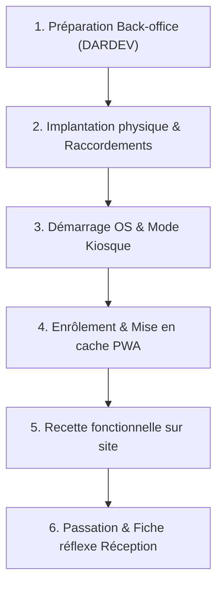
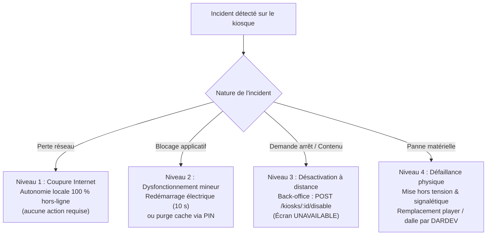

# Plan de Déploiement et d'Évaluation du Pilote en Hôtel — Projet Xplor

> **Référence contractuelle :** Cahier des charges Xplor v2.0 — Jalon **M8 — Durcissement & pilote** (S34–S37), Section 6 (Exigences fonctionnelles kiosque F-50 à F-67, F-80 à F-83), Section 8 (Exigences non fonctionnelles NF-01 à NF-05) et Section 9.  
> **Livrable associé :** Rapport de déroulement et de retour d'expérience du déploiement pilote.

---

> [!IMPORTANT]
> ### Règle fondamentale de gouvernance et d'exploitation
> **Le déploiement technique sur les environnements distants (serveur VPS de production `187.7.31.208`, routeurs, DNS et matériel physique sur site) est exclusivement ordonnancé et exécuté par le porteur du projet (Mourad / DARDEV).**  
> Conformément aux directives de sécurité du projet :
> - Les agents d'assistance et contributeurs ne disposent d'aucun accès SSH direct au serveur et n'exécutent aucune commande de téléversement ou de modification distante.
> - Le matériel kiosque déployé sur site est préparé, configuré et installé sous la supervision directe du porteur du projet.
> - Aucun nom d'hôtel réel ni aucune coordonnée ou donnée personnelle n'est inventé ou figé dans la documentation : le présent document constitue un **plan-cadre et modèle opérationnel réutilisable**, utilisant des balises normalisées (`[Nom de l'hôtel partenaire]`, `[Ville]`, `[Nom du responsable]`).
> - **Conformité stricte à la loi marocaine 09-08 (CNDP) :** la borne fonctionne sans collecte d'aucune donnée à caractère personnel de voyageur (sessions anonymes, aucun nom, e-mail, photographie ou adresse IP conservé).

---

## 1. Cadre et Objectifs de la Phase Pilote

La phase pilote en établissement hôtelier constitue l'étape de validation en conditions opérationnelles réelles préalablement à la livraison finale (M9) et à l'industrialisation à grande échelle (Phase 2 — déploiement dans le réseau d'hôtels partenaires 4★, 5★ et de luxe de la région pilote).

### 1.1 Objectifs principaux
1. **Éprouver l'ergonomie physique et logicielle :** Valider la prise en main spontanée de la borne tactile par les touristes et résidents de l'hôtel, sans assistance humaine requise.
2. **Confirmer la robustesse en conditions réelles :** Démontrer l'autonomie 100 % hors-ligne de la PWA Kiosque (`CacheStorage`, Service Worker, IndexedDB) face aux aléas de connectivité du réseau local de l'établissement.
3. **Valider la boucle d'incitation (Mode Veille Attract) :** Mesurer l'efficacité de la rotation douce des panoramas 360° pour capter le regard des voyageurs circulant dans le hall et susciter l'interaction tactile.
4. **Tester la passerelle Kiosque → Mobile (QR Code) :** Vérifier que les voyageurs scannent facilement le QR code d'une visite pour continuer leur exploration sur leur propre smartphone lors de leurs sorties.
5. **Mesurer l'impact pour l'établissement :** Fournir à la direction de l'hôtel des données objectives de fréquentation touristique via le tableau de bord analytique dédié (`apps/admin`), valorisant son rôle d'ambassadeur de la destination.
6. **Consigner les retours et préparer l'industrialisation :** Identifier les ajustements logiciels, de contenu ou d'aménagement avant l'extension du parc de bornes.

---

## 2. Prérequis Matériels et d'Infrastructure

Avant toute expédition ou installation sur site, les équipements et prérequis suivants doivent être réunis et vérifiés en atelier de préparation.

### 2.1 La borne tactile interactive (Totem ou Pupitre)

| Composant | Spécification requise | Justification technique & ergonomique |
|---|---|---|
| **Format mécanique** | Totem autoportant ou pupitre incliné (15° à 30°), châssis métallique thermolaqué avec serrures à clé sécurisées. | Stabilité au sol dans un lieu de passage ; protection contre le basculement et le vandalisme ; accès sécurisé aux composants internes. |
| **Hauteur d'interaction** | Commandes tactiles principales situées entre **80 cm et 130 cm** du sol. | Conformité aux normes d'accessibilité universelle et PMR (Personnes à Mobilité Réduite en fauteuil). |
| **Dalle d'affichage** | Écran 43 pouces ou 55 pouces (orientation portrait ou paysage selon agencement du hall). | Présence visuelle forte dans le hall pour attirer l'attention des visiteurs. |
| **Technologie tactile** | Dalle capacitive projetée (PCAP) multipoint (**≥ 10 points de contact simultanés**), temps de réponse < 10 ms. | Réactivité fluide pour la rotation du panorama 360° au doigt, compatible avec doigts humides ou légers effleurements. |
| **Résolution & dalle** | Dalle IPS Full HD (1920×1080) ou 4K Ultra HD, angle de vision large (≥ 178° H/V), verre trempé sécurisé anti-choc (indice IK08). | Lisibilité sous tous les angles de vue ; résistance aux chocs du quotidien dans un lieu public. |
| **Luminosité & traitement** | Luminosité **≥ 400 cd/m²**, traitement de surface antireflet mat. | Visibilité optimale même en cas de fort éclairage naturel ou de spots directionnels dans le hall. |

### 2.2 Unité de calcul embarquée (Mini-PC / Player kiosque)

Le player est logé à l'intérieur du caisson verrouillé de la borne :
- **Processeur :** Architecture x86-64, Intel Core i3/i5 (12e/13e génération) ou AMD Ryzen 5 Embedded.
- **Mémoire vive (RAM) :** 8 Go minimum (16 Go recommandé) pour assurer un rendu 360° fluide sans saturation mémoire.
- **Stockage :** SSD NVMe de **≥ 128 Go** (vitesse de lecture séquentielle ≥ 1 500 Mo/s pour chargement instantané des tuiles équirectangulaires locales).
- **Accélération graphique :** GPU compatible WebGL 2.0 avec accélération matérielle active dans Chromium (maintien d'un framerate constant ≥ 60 fps pour Photo Sphere Viewer v5).
- **Système d'exploitation :** Ubuntu 24.04 LTS (ou Windows 10/11 IoT Enterprise) configuré en **mode kiosque dédié et verrouillé** :
  - Démarrage automatique direct sur la session restreinte sans mot de passe (autologin).
  - Absence totale d'environnement de bureau, barre des tâches, notifications ou curseur de souris parasite.
  - Neutralisation matérielle et logicielle des combinaisons de touches d'évasion (Alt+F4, Ctrl+Alt+Suppr, touches Windows).
  - Ports USB externes de la borne physiquement inaccessibles ou désactivés au niveau du BIOS/OS pour prévenir tout branchement de périphérique non autorisé.

### 2.3 Pack Réalité Virtuelle (Optionnel / Démonstrateur en hall)

Si l'hôtel opte pour la mise à disposition d'un casque VR en libre accès surveillé ou auprès de la conciergerie :
- **Casque autonome :** Meta Quest 3 (ou Quest 2), système Meta Horizon OS v60+ à jour.
- **Navigateur :** Meta Quest Browser supportant WebXR Immersive-VR.
- **Sécurisation physique :** Câble antivol rétractable fixé au mobilier d'accueil ou mise à disposition sur demande au comptoir conciergerie.
- **Hygiène :** Station de désinfection, lingettes antiseptiques sans alcool adaptées aux lentilles optiques, et protections hygiéniques jetables pour le visage.

### 2.4 Environnement d'implantation et connectivité sur site

- **Emplacement retenu :** Hall d'accueil principal de l'hôtel, zone de circulation naturelle à fort passage (à proximité de la réception, de la conciergerie ou des salons d'attente), en dehors des couloirs d'évacuation d'urgence et à l'abri d'un ensoleillement direct prolongé sur la dalle.
- **Alimentation électrique :** Prise murale 220V/16A standard dédiée. La borne doit être raccordée à un **onduleur (UPS) de secours line-interactive** (capacité minimale 650 VA / 360 W) intégré dans le coffre technique, assurant une autonomie de 10 à 15 minutes pour absorber les micro-coupures réseau électrique sans redémarrage brutal.
- **Connectivité réseau :**
  - **Liaison prioritaire :** Câble Ethernet RJ45 Gigabit (Catégorie 6) relié au switch de l'établissement (VLAN invité ou VLAN IoT dédié disposant d'un accès direct à Internet).
  - **Liaison de secours :** Wi-Fi 5 GHz dédié (normes 802.11ac/ax, chiffrement WPA2/WPA3 Personnel ou Entreprise) avec niveau de signal mesuré à la borne **≥ -65 dBm**.
  - **Filtrage réseau et pare-feu :** Seuls les flux sortants standards en **HTTPS (port 443 TCP)** et WebSockets sécurisés vers les domaines de la plateforme Xplor sont requis (`api.xplor.ma`, `admin.xplor.ma`, `v.xplor.ma`, `media.xplor.ma`). **Aucun port entrant ne doit être ouvert sur le réseau de l'hôtel.**
  - **Débit Internet disponible :** Minimum 10 Mbps montant/descendant (20 Mbps recommandé pour la synchronisation initiale du cache des médias et tuiles 360°).

---

## 3. Checklist d'Installation et de Mise en Service

Cette checklist méthodologique est déroulée séquentiellement par le porteur du projet (DARDEV) lors du déploiement de la borne dans l'établissement partenaire.



### Étape 1 : Préparation préalable dans le back-office Xplor (DARDEV)

- [ ] **Création de la fiche hôtel :** Dans le back-office d'administration (`/hotels`), création de l'établissement avec ses attributs réels :
  - Nom officiel de l'établissement : `[Nom de l'hôtel partenaire]`
  - Classement : `[ex. 5 étoiles / Palace]`
  - Ville de rattachement : `[ex. Rabat / Salé / Kénitra]`
  - Adresse et coordonnées de contact de la direction
  - Code couleur hexadécimal de la marque de l'hôtel (appliqué à l'en-tête et aux accents du kiosque)
  - Langues activées : Français (`fr`), Arabe (`ar`), Anglais (`en`)
- [ ] **Configuration de la sélection de visites de l'hôtel :**
  - Sélection des visites régionales pertinentes dans le catalogue publié
  - Désignation de la visite mise en avant (`featuredTourId`) affichée en première position
  - Sélection des visites participant à la rotation du mode veille attract (`attractTourIds`)
  - Validation et incrémentation de la version de sélection
- [ ] **Création de l'entité Kiosque :** Dans la rubrique `/kiosks`, création du kiosque rattaché à l'hôtel :
  - Libellé : `[ex. Borne Hall Principal]`
  - Type : `TOUCH_SCREEN` (Écran tactile)
  - Délai d'inactivité avant veille : configuré à **60 secondes** (temps adapté à un hall d'hôtel)
- [ ] **Génération du code d'enrôlement :** Clic sur « Générer un code d'enrôlement » : relève du code alphanumérique unique à 8 caractères (valable 24 heures).
- [ ] **Configuration du code PIN de maintenance :** Attribution du code PIN secret de l'établissement (minimum 4 chiffres) pour le déverrouillage technique local.

### Étape 2 : Implantation physique et raccordements sur site

- [ ] Réception et inspection visuelle de la borne (absence d'impact ou de rayure sur la dalle tactile).
- [ ] Positionnement à l'emplacement convenu dans le hall de l'hôtel.
- [ ] Réglage des patins de stabilisation au sol et vérification de la parfaite verticalité/assiette.
- [ ] Raccordement du câble d'alimentation secteur à l'onduleur interne, et mise sous tension de l'onduleur.
- [ ] Raccordement du câble Ethernet RJ45 au connecteur réseau de la borne (ou configuration du Wi-Fi).
- [ ] Vérification de la dissimulation totale des câbles dans la goulotte technique sécurisée.
- [ ] Contrôle des serrures d'accès au compartiment technique.

### Étape 3 : Démarrage du système et amorçage du mode kiosque

- [ ] Démarrage du mini-PC (vérification dans le BIOS de l'activation de l'option *AC Power Loss : Power On* garantissant le réallumage automatique après coupure de courant).
- [ ] Ouverture automatique de la session système restreinte (sans bureau ni demande d'identifiants).
- [ ] Lancement automatique du navigateur Chromium en mode kiosque étanche avec les paramètres stricts :
  ```bash
  chromium-browser \
    --kiosk \
    --incognito \
    --noerrdialogs \
    --disable-pinch \
    --overscroll-history-navigation=0 \
    --disable-features=TranslateUI \
    --disable-session-crashed-bubble \
    --check-for-update-interval=31536000 \
    https://v.xplor.ma/kiosk
  ```
- [ ] Constat de l'affichage en plein écran de la mire initiale **ENROLL** de la PWA Xplor (« Enrôlement du kiosque »).

### Étape 4 : Enrôlement applicatif et synchronisation du cache local

- [ ] Saisie sur le clavier virtuel tactile du code d'enrôlement à 8 caractères préparé à l'étape 1.
- [ ] Validation de l'enrôlement :
  - Constat de l'appel `POST /api/v1/kiosk/enroll` avec émission du jeton 256 bits d'appareil.
  - Vérification de la persistance sécurisée du jeton dans IndexedDB (`xplor.kiosk.credentials`).
  - Téléchargement du manifeste personnalisé de l'hôtel (`GET /api/v1/kiosk/manifest`).
- [ ] Amorçage du Service Worker (`public/sw.js`) :
  - Téléchargement en tâche de fond de l'ensemble des dérivés médias et des tuiles 360° pour les visites sélectionnées.
  - Stockage dans `CacheStorage` sous les clés versionnées `tour-<id>`.
- [ ] Basculement automatique de l'écran sur la vue d'accueil **HOME** personnalisée aux couleurs et logo de l'hôtel partenaire.

### Étape 5 : Recette fonctionnelle sur place

- [ ] **Navigation tactile :** Lancement de la visite mise en avant, rotation 360° fluide au doigt, zoom progressif, réactivité immédiate sans saccade (≥ 60 fps).
- [ ] **Hotspots interactifs :** Activation d'un hotspot de transition de scène (`SCENE_LINK`) et ouverture d'une fiche d'information descriptive (`INFO`).
- [ ] **Support multilingue & RTL :** Basculement de l'interface en Arabe via le sélecteur d'en-tête (constat de la disposition miroir immédiate `dir="rtl"` sans rechargement de page), puis test en Anglais et retour en Français.
- [ ] **Test d'autonomie hors-ligne (Offline) :**
  - Débranchement physique du câble réseau RJ45 de la borne.
  - Rechargement de la page et navigation complète à travers les différentes scènes : constat que la navigation 360° et les contenus restent 100 % opérationnels depuis le cache local sans aucun message d'erreur.
  - Rebranchement du câble réseau : constat du rétablissement transparent de la connectivité.
- [ ] **Test de la boucle de veille attract :**
  - Laisser la borne sans contact pendant 60 secondes.
  - Constat du retour automatique à l'accueil puis de l'entrée en mode veille **ATTRACT** (rotation lente du panorama 360° configuré et affichage du message tactile invitant à l'exploration).
- [ ] **Test du réveil tactile :** Effleurement de l'écran tactile : réveil immédiat et retour sur l'accueil avec initialisation d'une nouvelle session anonyme `sessionId`.
- [ ] **Test du déverrouillage de maintenance :**
  - Réalisation du geste secret : 5 tapotements rapides (en moins de 3 secondes) sur le nom ou logo de l'hôtel dans l'en-tête.
  - Saisie du code PIN secret sur le pavé numérique virtuel tactile.
  - Constat de l'ouverture de l'écran technique de maintenance (vérification de l'état du réseau, de la mémoire libre, de l'état de synchronisation du cache et de l'espace disque).
- [ ] **Test de la passerelle QR code mobile :**
  - Ouverture d'une fiche de visite sur la borne.
  - Scan du QR code affiché à l'aide d'un smartphone personnel : constat de l'ouverture instantanée de la visite sur `https://v.xplor.ma/v/:token?src=kiosk` avec conservation du paramètre de provenance.

### Étape 6 : Clôture de l'installation et passation

- [ ] Fermeture à clé du caisson technique de la borne et conservation des clés par le porteur et la direction de l'hôtel.
- [ ] Remise au personnel d'accueil et conciergerie de la **Fiche réflexe d'exploitation** (marche/arrêt, nettoyage de la dalle, gestes simples de premier niveau et numéro du support).
- [ ] Signature conjointe de la fiche d'installation sur site.

---

## 4. Procédure de Retour Arrière (Rollback) et Gestion des Incidents

La matrice ci-dessous définit la conduite opérationnelle à tenir en fonction de la nature et de la gravité des incidents susceptibles de survenir durant la phase pilote.



### 4.1 Procédures détaillées par niveau de criticité

#### Niveau 1 — Perte de connectivité Internet locale
- **Symptôme :** Coupure du lien Internet de l'hôtel ou défaillance du réseau Wi-Fi/Ethernet interne.
- **Impact utilisateur :** **Aucun impact visible.** L'application kiosque a été conçue selon une architecture *Offline-First* intégrale :
  - Le Service Worker continue de servir l'ensemble du shell applicatif et les tuiles des visites en cache.
  - Les événements statistiques de consultation sont stockés localement dans la file IndexedDB.
- **Action requise :** Aucune action immédiate d'urgence. Dès le rétablissement de la connectivité réseau par l'hôtel, le kiosque reprend automatiquement ses appels de pulsation (`POST /kiosk/heartbeat`) et dépile la file d'attente des événements vers l'API sans perte de données.

#### Niveau 2 — Blocage logiciel ou comportement inattendu de l'interface
- **Symptôme :** Écran tactile figé, asset visuel corrompu ou absence de réponse aux effleurements.
- **Procédure de 1er niveau (Équipe de l'hôtel) :**
  1. Basculer l'interrupteur d'alimentation situé à l'arrière ou sous le socle de la borne sur la position `Arrêt`.
  2. Patienter 10 secondes afin de décharger totalement les condensateurs du mini-PC.
  3. Réenclencher l'alimentation sur `Marche` : le système redémarre automatiquement en session kiosque et recharge l'application nominale en moins de 45 secondes.
- **Procédure de 2nd niveau (Support technique DARDEV) :**
  1. Effectuer le geste secret (5 tapotements sur l'en-tête) et saisir le code PIN de maintenance.
  2. Sur l'écran technique, cliquer sur le bouton **« Réinitialiser le cache et resynchroniser »**.
  3. La borne purge ses données temporaires `CacheStorage` et retélécharge un manifeste frais depuis l'API.

#### Niveau 3 — Suspension immédiate à distance (Incident de contenu ou de gestion)
- **Symptôme :** Demande formulée par la direction de l'hôtel ou le porteur d'interrompre temporairement la consultation de la borne (événement privé dans le hall, mise à jour critique de catalogue, etc.).
- **Procédure d'exécution (Porteur DARDEV) :**
  1. Se connecter sur le back-office d'administration : `https://admin.xplor.ma/kiosks`.
  2. Sélectionner le kiosque concerné et cliquer sur l'action **« Désactiver le kiosque »** (`POST /api/v1/admin/kiosks/:id/disable`).
  3. Lors de son prochain heartbeat ou notification, la borne bascule instantanément sur l'écran sécurisé neutre :  
     *« Service momentanément indisponible — Nos équipes effectuent une opération de maintenance. »*
  4. La réactivation s'effectue en un clic sur **« Activer »** dans le back-office sans déplacement sur site.

#### Niveau 4 — Défaillance matérielle critique (Écran noir, panne électrique, choc physique)
- **Symptôme :** La borne ne s'allume plus, l'écran reste noir malgré le courant, ou la dalle présente une détérioration physique.
- **Procédure d'exécution :**
  1. Débrancher la prise d'alimentation secteur murale pour isoler l'appareil en toute sécurité.
  2. Poser la housse ou le panneau d'élégance siglé fourni lors de l'installation indiquant : *« Dispositif en cours d'optimisation technique »*.
  3. Aviser immédiatement le responsable de déploiement DARDEV par téléphone/courriel.
  4. Intervention sur site par le porteur du projet sous 24 à 48 heures ouvrées avec le matériel de réserve (mini-PC ou dalle de remplacement configuré en atelier).
  5. En cas de remplacement du mini-PC : saisie d'un nouveau code d'enrôlement généré depuis le back-office pour réassocier le nouveau matériel à l'hôtel en conservant son historique statistique.

#### Dépose définitive ou clôture du pilote
- Désenrôlement logique du kiosque dans le back-office (`DELETE /api/v1/admin/kiosks/:id`).
- Purge sécurisée des disques du mini-PC (suppression des jetons d'appareil).
- Démontage, reconditionnement et transport sécurisé par DARDEV.

---

## 5. Indicateurs de Performance et Données à Observer

Pendant la durée du déploiement pilote, les indicateurs sont suivis de façon hebdomadaire conjointement par le porteur du projet (DARDEV) et le référent de l'hôtel partenaire.

```
┌────────────────────────────────────────────────────────────────────────┐
│                        TABLEAU DE BORD PILOTE                          │
│                                                                        │
│   Sessions totales        Durée moyenne        Visites ouvertes        │
│      [XXXX]                 [Xm XXs]               [XXXX]              │
│                                                                        │
│   Scènes explorées       Taux Mode VR         Scans QR Mobile          │
│      [XXXX]                   [XX %]               [XXXX]              │
└────────────────────────────────────────────────────────────────────────┘
```

### 5.1 Indicateurs quantitatifs mesurés par la plateforme Xplor

*Toutes les données sont collectées de façon strictement anonyme sans aucun identifiant personnel (conformité loi 09-08 CNDP).*

| Indicateur clé | Méthode de mesure | Seuil cible / Interprétation |
|---|---|---|
| **Volume de sessions** | Nombre total de sessions initiées sur la borne (`SESSION_START`). | **≥ 30 à 50 sessions / jour** selon la fréquentation du hall. |
| **Durée moyenne de session** | Intervalle de temps écoulé entre `SESSION_START` et `SESSION_END` (ou inactivité). | **Entre 1 min 30 s et 4 min** (témoigne d'une consultation attentive sans monopolisation excessive). |
| **Taux de rebond / écourté** | Sessions de moins de 15 secondes sans interaction. | **< 20 %** des sessions démarrées. |
| **Profondeur de navigation** | Nombre moyen de scènes visitées par session (`SCENE_VIEW`). | **≥ 3 scènes / session** (exploration active du patrimoine). |
| **Top 5 des visites plébiscitées** | Classement des visites par nombre d'ouvertures (`TOUR_VIEW`). | Identification des sites touristiques suscitant le plus fort attrait auprès des touristes. |
| **Intérêt informatif** | Clics sur les points d'intérêt descriptifs enrichis (`HOTSPOT_CLICK` type `INFO`). | Ratio ≥ 1 clic d'information par visite ouverte. |
| **Passerelle mobile (QR Code)** | Nombre de scans du QR code de partage (`src=kiosk`). | **≥ 10 à 15 % des sessions**, attestant du désir de poursuivre la visite en extérieur. |
| **Attrait du mode veille (Attract)** | Nombre de réveils tactiles (`WAKE`) déclenchés depuis la boucle de veille. | Évalue le pouvoir d'accroche visuel de la borne dans le hall. |
| **Répartition linguistique** | Part des consultations en Français, Arabe et Anglais. | Adaptation de l'offre culturelle aux profils de la clientèle de l'hôtel. |
| **Disponibilité technique (Uptime)** | Ratio de réceptions des heartbeats réguliers (`POST /kiosk/heartbeat` toutes les 5 min). | **≥ 99,0 % de disponibilité** sur la durée du pilote. |

### 5.2 Retours qualitatifs et observations d'usage sur site

- **Facilité d'appropriation :** Les usagers comprennent-ils spontanément qu'il s'agit d'un écran tactile 360° interactif ? La mention « Touchez l'écran pour explorer » est-elle claire ?
- **Fluidité ressentie :** Les transitions entre scènes et la manipulation à 360° sont-elles perçues comme agréables, sans latence ni flou prolongé ?
- **Perception du personnel hôtelier :**
  - La borne allège-t-elle les sollicitations répétitives auprès de la conciergerie pour les conseils touristiques de base ?
  - La conciergerie utilise-t-elle la borne comme support pour orienter les clients vers des visites locales ?
  - Des dysfonctionnements ou blocages ont-ils été remontés par les clients au comptoir ?
- **Impact d'image :** La borne contribue-t-elle à moderniser l'expérience d'accueil et à valoriser la politique d'innovation de l'hôtel ?

---

## 6. Modèle de Rapport de Bilan de Pilote

*Ce modèle prêt à l'emploi est complété par le porteur du projet à l'issue de la période pilote pour formaliser le retour d'expérience et statuer sur le passage en Phase 2.*

---

### FICHE SIGNALÉTIQUE DU DÉPLOIEMENT PILOTE

| Rubrique | Information / Constat |
|---|---|
| **Établissement d'accueil** | `[Nom de l'hôtel partenaire à compléter]` |
| **Catégorie de l'hôtel** | `[ex. 5 étoiles / Palace]` |
| **Ville / Emplacement** | `[Ville et adresse de l'établissement à compléter]` |
| **Emplacement dans le hall** | `[ex. Face aux ascenseurs principaux / Espace conciergerie / Salon d'accueil]` |
| **Période d'observation** | Du `[Date début : JJ/MM/AAAA]` au `[Date fin : JJ/MM/AAAA]` (Durée : `[X]` semaines) |
| **Identifiant du kiosque (Back-office)** | `[UUID ou label du kiosque, ex. KIOSK-HOTEL-01]` |
| **Matériel déployé** | `[ex. Totem tactile 55 pouces 4K PCAP, Mini-PC i5 16 Go SSD 256 Go, Ubuntu 24.04]` |
| **Référent de l'établissement** | `[Titre / Fonction du référent hôtel, ex. Directeur de l'Hébergement / Chef Concierge]` |
| **Responsable du déploiement (DARDEV)** | `[Porteur du projet]` |

---

### SYNTHÈSE STATISTIQUE DE LA PÉRIODE PILOTE

*Données consolidées extraites de l'export CSV du tableau de bord Xplor.*

| Métrique observée | Valeur enregistrée | Valeur cible / Référence | Appréciation |
|---|---|---|---|
| **Nombre total de jours d'exploitation** | `[XX]` jours | `[XX]` jours | Conforme |
| **Taux de disponibilité matérielle (Uptime)** | `[XX,X]` % | ≥ 99,0 % | `[Satisfaisant / À améliorer]` |
| **Nombre total de sessions démarrées** | `[XXXX]` sessions | ≥ 30 sessions / jour | `[Satisfaisant / À améliorer]` |
| **Moyenne de sessions quotidiennes** | `[XX]` sessions / jour | ≥ 30 sessions / jour | `[Satisfaisant / À améliorer]` |
| **Durée moyenne par session** | `[X]` min `[XX]` s | 1 min 30 s – 4 min | `[Satisfaisant / À améliorer]` |
| **Nombre total de scènes 360° visualisées** | `[XXXX]` vues | — | `[Satisfaisant / À améliorer]` |
| **Nombre de clics sur les hotspots d'info** | `[XXXX]` interactions | — | `[Satisfaisant / À améliorer]` |
| **Scans QR code pour poursuite mobile** | `[XXX]` scans (`[XX]` %) | ≥ 10 % | `[Satisfaisant / À améliorer]` |
| **Sessions en Réalité Virtuelle (si pack VR)** | `[XXX]` sessions (`[XX]` %) | — | `[Satisfaisant / À améliorer]` |
| **Répartition linguistique observée** | FR : `[XX]` % &nbsp; AR : `[XX]` % &nbsp; EN : `[XX]` % | — | `[Équilibrée / Prédominance]` |

---

### TOP 5 DES VISITES VIRTUELLES LES PLUS CONSULTÉES

| Rang | Intitulé de la visite virtuelle | Catégorie | Nombre de consultations | Durée cumulée d'exploration |
|---|---|---|---|---|
| **1** | `[Titre de la visite 1]` | `[Catégorie]` | `[XXXX]` vues | `[XX]` heures |
| **2** | `[Titre de la visite 2]` | `[Catégorie]` | `[XXXX]` vues | `[XX]` heures |
| **3** | `[Titre de la visite 3]` | `[Catégorie]` | `[XXXX]` vues | `[XX]` heures |
| **4** | `[Titre de la visite 4]` | `[Catégorie]` | `[XXXX]` vues | `[XX]` heures |
| **5** | `[Titre de la visite 5]` | `[Catégorie]` | `[XXXX]` vues | `[XX]` heures |

---

### ANALYSE DU RETOUR D'EXPÉRIENCE TERRAIN

#### 1. Points forts confirmés lors du pilote
- `[Point fort 1 : ex. Excellente robustesse du mode hors-ligne lors d'une coupure Internet locale de 4 h sans interruption de service]`
- `[Point fort 2 : ex. Forte attraction de la boucle de veille attract suscitant une curiosité spontanée des voyageurs]`
- `[Point fort 3 : ex. Richesse des contenus 360° plébiscitée par la clientèle internationale en anglais et arabe]`

#### 2. Difficultés, points de friction et axes d'amélioration
- `[Axe d'amélioration 1 : ex. Reflet lumineux constaté à certaines heures nécessitant un léger réajustement d'orientation du totem]`
- `[Axe d'amélioration 2 : ex. Demande d'intégration d'un bouton « Retour à l'accueil » encore plus visible lors de l'exploration de scènes complexes]`
- `[Axe d'amélioration 3 : ex. Suggestion de la conciergerie d'ajouter un filtre par durée estimée de visite touristique]`

---

### REGISTRE DES INCIDENTS SURVENUS DURANT LE PILOTE

| Réf. | Date / Heure | Typologie | Description de l'événement | Impact usagers | Action corrective appliquée | Délai de résolution |
|---|---|---|---|---|---|---|
| `INC-01` | `[JJ/MM/AAAA]` | `[Réseau / Matériel / Logiciel]` | `[Description précise de l'incident]` | `[Nul / Mineur / Majeur]` | `[Action corrective mise en œuvre]` | `[XX min / XX h]` |
| `INC-02` | `[JJ/MM/AAAA]` | `[Réseau / Matériel / Logiciel]` | `[Description précise de l'incident]` | `[Nul / Mineur / Majeur]` | `[Action corrective mise en œuvre]` | `[XX min / XX h]` |

*(Si aucun incident n'est survenu, porter la mention explicite « Néant — 100 % de disponibilité nominale »).*

---

### RECOMMANDATIONS STRATÉGIQUES POUR LA PHASE 2 (GÉNÉRALISATION MULTI-HÔTELS)

1. **Recommandations matérielles et implantation :**  
   `[Synthèse des choix matériels validés ou à ajuster pour le déploiement du parc de 5 bornes en Phase 2]`
2. **Recommandations logicielles et fonctionnelles :**  
   `[Améliorations mineures à inscrire au backlog du jalon de livraison M9 / Phase 2]`
3. **Recommandations éditoriales et touristiques :**  
   `[Besoins de nouveaux tournages 360° ou enrichissements multimédias exprimés par les usagers]`

---

### CONCLUSION ET AVIS CONJOINT SUR LE PILOTE

- [ ] **PILOTE CONCLUANT SANS RÉSERVE :** La solution est déclarée pleinement mature pour l'extension à l'ensemble du réseau hôtelier de la région pilote et la mise en production définitive (M9).
- [ ] **PILOTE CONCLUANT SOUS CONDITIONS :** Déploiement généralisé autorisé sous réserve de la prise en compte des ajustements mineurs identifiés.
- [ ] **PILOTE NON CONCLUANT :** Nécessité d'une prolongation de test ou de refontes substantielles avant validation.

---

### ÉMARGEMENT ET VALIDATION DU RAPPORT

| Pour le Porteur du Projet (DARDEV) | Pour l'Établissement Hôtelier Partenaire | Pour le Partenaire Institutionnel (SMIT) |
|---|---|---|
| **Nom :** `[à compléter]` | **Nom :** `[à compléter]` | **Nom :** `[à compléter]` |
| **Fonction :** `[Porteur du projet]` | **Fonction :** `[Fonction du responsable]` | **Fonction :** `[Représentant SMIT]` |
| **Date :** `[JJ/MM/AAAA]` | **Date :** `[JJ/MM/AAAA]` | **Date :** `[JJ/MM/AAAA]` |
| **Signature :**<br><br><br><br> | **Signature :**<br><br><br><br> | **Signature :**<br><br><br><br> |
